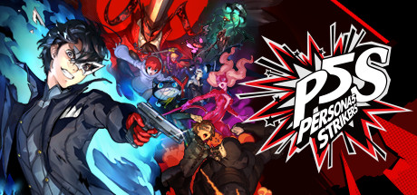

**Persona 5 Strikers is the action RPG sequel to Persona 5, blending Warriors-style combat with Persona's stylish aesthetics and story depth. Travel across Japan with the Phantom Thieves, invade Jails, and take down corrupted monarchs in high-speed supernatural battles.**

---

## 📖 About

Persona 5 Strikers is the action RPG sequel to Persona 5, blending Warriors-style combat with Persona's stylish aesthetics and story depth. Travel across Japan with the Phantom Thieves, invade Jails, and take down corrupted monarchs in high-speed supernatural battles.

## ⚠️ Problems Without Trainer

| Problem | Status |
|---------|--------|
| **Enemy Weakness Required** — Ignoring elemental weaknesses makes bosses nearly unkillable | ✅ Solved |
| **BOND Level Grind** — Passive upgrades require extensive grinding to unlock | ✅ Solved |
| **Difficulty Spikes** — Specific boss fights demand precise party compositions | ✅ Solved |
| **No Baton Pass** — Missing the action-RPG timing loop makes combat frustrating | ✅ Solved |

## ✅ Solution

The **Persona 5 Strikers Trainer** solves all these issues by giving you complete control over the game.

## 🎯 Full Feature List

- Unlimited Resources
- God Mode / Invincibility
- Instant Skill Cooldown
- One-Hit Kill
- Freeze Game Timer
- Unlock All Items & Achievements
- Custom Speed Multiplier
- Save State Anywhere

## 🚀 Quick Start

1. **Disable Windows Defender** temporarily (trainer may trigger false positive)
2. Download the trainer from the button above
3. Launch Persona 5 Strikers
4. Run the trainer as Administrator
5. Activate desired cheats with hotkeys

## 💎 Free vs Paid

| Feature | Free | Pro |
|---------|------|-----|
| Basic God Mode | ✅ | ✅ |
| Unlimited Resources | ✅ | ✅ |
| All Advanced Cheats | ❌ | ✅ |
| Auto-Updates | ❌ | ✅ |
| Priority Support | ❌ | ✅ |

## 💻 Requirements

- Windows 10/11 (64-bit)
- Persona 5 Strikers (any version)
- .NET Framework 4.8+
- DirectX 11+

## 🍎 macOS

macOS users can use our alternative tool:

## ⚖️ Legal

This trainer is for educational and single-player use only. Use responsibly.

---

